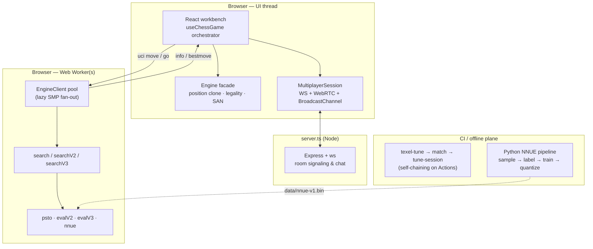

# Chess0 — Architecture

A from-scratch TypeScript chess engine with a full web workbench, a
zero-local-compute NNUE training pipeline, and a self-play tuning loop.
This document maps the territory: what lives where, how the pieces talk,
and which invariants hold the whole thing together.

For a feature tour see the [README](README.md); for contribution mechanics
see [CONTRIBUTING.md](CONTRIBUTING.md); for AI-agent operating rules see
[AGENTS.md](AGENTS.md).

## The three planes

The engine **never touches the DOM**. The UI thread keeps its own lightweight
`Position` for legality, SAN and game state; search lives entirely in Web
Workers, so the interface never freezes while the engine thinks.

## Engine core (`src/engine/`)

Pure TypeScript — no React, no DOM, no I/O. Everything below allocates
nothing on the hot path.

### Board & moves (`types.ts`)

- **0x88 mailbox** in a single `Int8Array`: square index = `rank * 16 + file`,
  on-board iff `(sq & 0x88) === 0` — off-board tests are one AND.
- Pieces are signed `Int8` (+white / −black); `pieceIndex()` maps any piece to
  `0..11` for table lookups.
- **Moves are packed 32-bit ints**: bits 0–6 from, 7–13 to, 14–16 promotion,
  17–19 captured type, 20–22 flags. Move lists are typed arrays.

### Position state (`position.ts`)

`Position` is a mutable struct with **incrementally maintained state** updated
inside `makeMove`/`unmakeMove`:

- Zobrist hash (two 32-bit halves; en-passant hashed only when actually
  capturable)
- PeSTO mg/eg material+PST accumulators and game phase
- Piece counts per type and non-pawn material buckets
- NNUE layer-1 accumulator stack (`nnueStack`) — see below

The test suite enforces the core invariant: **after any random walk of
make/unmake, every incremental field must equal a from-scratch recomputation**
(board, hash, eval accumulators, phase, piece counts — and the NNUE
accumulators).

### Move generation (`movegen.ts`)

Pseudo-legal generation with a pin-aware cheap legality test (origin-line
discovery check). Full attack scans run only for king moves, en passant and
check evasions. Verified against the 6 standard perft positions plus a
14-position edge-case suite.

### Evaluation — three generations

| File | What it is |
| --- | --- |
| `psto.ts` + `eval.ts` | PeSTO tapered eval (mg/eg PSTs blended by phase), incremental — ~8 ns/call |
| `evalV2.ts` | Extended eval: pawn structure, bishop pair, rook files, mobility, king safety |
| `evalV3.ts` | The v3 evaluation; optionally **delegates to NNUE** when an override net is set (see below) |
| `see.ts` | Static exchange evaluation, used by v2/v3 pruning and ordering |

### Search — three generations

| File | Adds |
| --- | --- |
| `search.ts` | Iterative deepening, negamax + PVS, quiescence with check evasions & delta pruning, MVV-LVA + killers + history, TT, null-move, LMR, check extension |
| `searchV2.ts` | Aspiration windows, counter-moves, reverse futility / futility pruning, SEE-based pruning |
| `searchV3.ts` | 2M-entry TT probed in search *and* qsearch (TT-scored eval refinement), singular extensions, continuation/countermove/capture history with gravity, SEE-classified ordering, razoring, ProbCut, late-move pruning, history-modulated LMR, adaptive time management |

`bookV3.ts` implements the **hybrid opening book**: at the root, book theory
is evaluated *alongside* the full search and the engine deviates when it
calculates a stronger novelty. It also powers the UI opening explorer
(master W/D/L stats, GM repertoire, tactical presets).

### NNUE inference (`nnue.ts`)

- Architecture: `768×32×2 → 32 → 1`, fully quantized — int16 layer-1 weights
  (QA=1024), int8 layers 2–3 (QB=64), ClippedReLU activations, SCALE=400.
- Input is 768 features from the **side-to-move perspective** (own pieces
  0–5, opponent 6–11), trained as **two independent views**, so layer 1
  keeps four H1-wide accumulators per ply on the position stack —
  slot layout `[V0W | V0B | V1W | V1B]` (white/black placements under both
  weight tables). Updates are per-move deltas; eval time reads two slots.
- Weights load from `data/nnue-v1.bin` (little-endian, magic `C0NNUE01`,
  header carries `IN/H1/H2/QA/QB/SCALE` so the runtime validates the file).
- The feature extraction and every quantization step are **mirrored
  bit-for-bit in `training/nnue_train.py`**; `scripts/nnue-verify.ts` gates
  TS ↔ Python parity after every training run.
- Today the net is used as a validated **eval override for v3 in engine
  matches** (`scripts/match.ts` mode `v3nnue`) while it banks rating games;
  the browser build runs the hand-written eval.

## Worker protocol & lazy SMP (`engineClient.ts`, `enginePool.ts`)

- `EngineClient` wraps one Web Worker behind a promise API
  (`reset / move / undo / search / terminate`), streaming `info` events
  (depth, seldepth, nodes, nps, Multi-PV lines).
- `EnginePoolClient` fans out to N workers ("lazy SMP by message passing"):
  - every position-changing message is **broadcast** so all private
    positions stay mirrored;
  - time-based searches run on all workers, **best result wins** (deepest
    completed iteration, then most nodes) while node counts are summed for
    display; the leader (worker 0) streams `info`;
  - deterministic depth-limited searches run on the leader only — identical
    workers with independent random TT collisions would just duplicate work.
- Independent-TT message passing needs **no SharedArrayBuffer**, so SMP works
  on static hosting (GitHub Pages) as well as locally.

## UI plane (`src/`)

- **`useChessGame.ts`** is the orchestrator: one hook owning the game
  position, history with per-move analysis, modes
  (`hve / pvp / puzzle / academy / eve / analysis`), bot play styles
  (`learn / comp`), competitive Elo, puzzle and academy state, multiplayer
  session, sounds and theme. Components are thin and props-driven.
- **`analysis.ts`** turns search results into chess.com-style move
  classifications (brilliant → best → good → book → inaccuracy → mistake →
  blunder) with win-probability math (`cpToWinProb`), move accuracy and
  game-summary accuracy stats.
- **`multiplayer.ts`** is a **triple-transport** room client — server
  WebSockets (`/ws`), PeerJS WebRTC DataChannels (serverless play, because
  GitHub Pages has no backend) and BroadcastChannel (multi-tab). All state
  updates are idempotent, keyed by roomId + move ply + chat id.
- **`sound.ts` / `coachTts.ts`** — synthesized move sounds and the spoken
  coach (Web Speech API).
- Styling uses the **semantic token system** in `src/index.css`
  (`bg-surface`, `text-ink-2`, `border-line`, …) — components should never
  introduce new arbitrary hex colors; the tokens flip light/dark in one place.

## Server (`server.ts`)

A small Express app with a `ws` WebSocketServer: hands out 6-digit room
codes, relays room state (moves, chat, resign/draw flags), and — in dev mode
(`npm run dev`) — hosts the Vite middleware so the app and multiplayer run on
one port (3000). In production it serves `dist/` statically.

## Training plane (`training/`, `scripts/gen-nnue-data.ts`)

Zero local compute: GitHub Actions does data, free Kaggle GPUs train.

1. **Sample** the Lichess open game database into a uniform position corpus
   (`training/build_uniform_sample.py`)
2. **Label** with Stockfish (`training/sf_label.py`), or start from the
   pre-labeled Stockfish Kaggle dataset
3. **Train** quantization-aware PyTorch net (`training/nnue_train.py`);
   supports distillation fine-tuning (`--resume`)
4. **Verify** (`scripts/nnue-verify.ts`, POV-audited data loaders — every
   `.bin` data path checks piece/color perspective)

Full runbook with click-by-click instructions: [training/README.md](training/README.md).

## Tuning plane (`scripts/tune-*.ts`)

The engine improves itself:

1. `texel-tune.ts` — texel-gradient tuning of eval parameters on quiet
   positions (compact corpus, time-budgeted)
2. `match.ts` — champion/challenger engine matches (80 games, ≥ 60 % score
   to accept, wall-budget safety stops), SPRT-style
3. `tune-session.ts` — chains the cycle: tune → gate → publish accepted
   champion to `main` → pick up the next parameter set
4. `.github/workflows/tune.yml` runs these as **matrix-parallel overnight
   self-chaining sessions**, so `main` gets stronger autonomously

## Verification layers

| Layer | Command | What it proves |
| --- | --- | --- |
| Perft | `npm run perft` | move generation is exactly correct (6 standard + 14 edge-case positions) |
| Unit gates | `npm test` | FEN round-trips, make/unmake incremental state, eval mirror symmetry, known mates, SAN, insufficient material, NNUE accumulator regression |
| Parity | `npx tsx scripts/nnue-verify.ts` | TS NNUE inference ≡ Python trainer reference evals |
| Bench | `npm run bench` | v1 ≥ 1 M nps and depth ≥ 9 @ 1 s gate; v2/v3 tracked for regressions |
| Play | `npx tsx scripts/match.ts` | strength changes actually win games (80-game gate) |

## Design invariants (the laws)

1. **Engine purity** — `src/engine/` contains no DOM, React or I/O code.
2. **Zero allocation on the hot path** — packed moves, typed arrays,
   preallocated undo stacks.
3. **Incremental == recomputed** — every cached field must survive the
   random-walk equivalence checks; a stale accumulator is a bug class of its
   own (the NNUE stale-slot edge case is documented in the test suite).
4. **TS ↔ Python parity** — the NNUE spec block in `nnue.ts` and
   `nnue_train.py` must never diverge; change both or neither.
5. **POV auditing** — every data path that touches pieces/colors is gated
   against perspective bugs.
6. **Strength changes need games** — eval/search modifications earn their
   way in through the 80-game match gate, not vibes.
