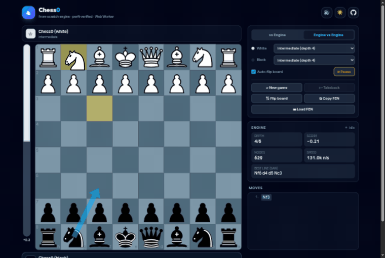
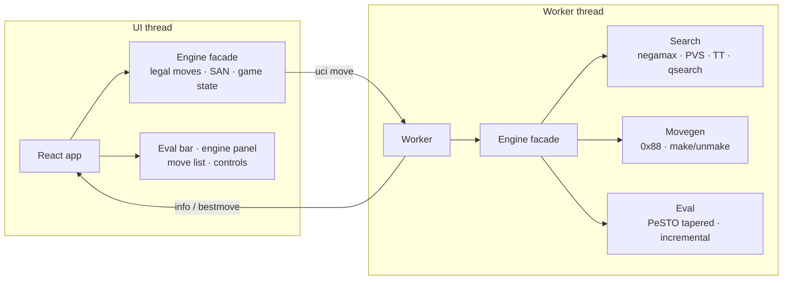

<div align="center">

# ♞ Chess0

**[▶ PLAY LIVE](https://aryan007h.github.io/chess0/)**

*A chess engine written 100% from scratch in TypeScript — rules, move generation,
evaluation and search — playing in your browser at over a million nodes per second.*



[](https://www.typescriptlang.org/)
[](https://react.dev/)
[](https://vite.dev/)
[](#verification--perft)
[](#verification--perft)
[](LICENSE)

</div>

---

## The pitch

No `chess.js`. No engine libraries. Every rule of chess — castling, en passant,
pins, the fifty-move rule — plus a full alpha-beta search with a transposition
table runs on code in this repository, verified node-for-node against the
standard perft test suite and fast enough to see it think.

## Features

- **Play vs the engine** — Random / Beginner (depth 2) / Intermediate (depth 4) /
  Full strength (1 s per move) / **Chess0 v2** (stronger search + richer eval)
- **Engine vs Engine spectator mode** with auto-flip board
- **Live eval bar**, engine info panel (depth / seldepth / nodes / NPS / best line in SAN),
  PV arrow drawn on the board
- Click-to-move **and** drag & drop, legal-move dots, capture rings,
  last-move + check highlights, promotion picker
- Move list in **SAN** (`Nbd7`, `exd6`, `O-O-O`, `Rd8#`), takeback, board flip,
  side picker, FEN load/copy, result modal with the exact draw reason
- Dark mode, responsive layout, synthesized move sounds — all client-side,
  the UI never freezes because the engine runs in a **Web Worker**

## The engine

| Layer | Choice |
| --- | --- |
| Board | **0x88 mailbox** in a single `Int8Array`; off-board tests are one AND |
| Moves | Packed into 32-bit ints; make/unmake with preallocated undo stacks — zero allocation on the hot path |
| Legality | Pin-aware cheap test (origin-line discovery check) with full attack scan only for king moves, en passant and check evasions |
| Hashing | Zobrist, two 32-bit halves; en-passant hashed only when actually capturable |
| Evaluation | **PeSTO** tapered eval (mg/eg piece-square tables blended by game phase), maintained incrementally — **~8 ns per call** |
| Search | Iterative deepening, negamax + PVS, quiescence with check evasions & delta pruning, MVV-LVA + killers + history ordering, transposition table, null-move pruning, LMR, check extension |
| Chess0 v2 | Everything above plus aspiration windows, counter-moves, reverse futility / futility pruning, SEE-based pruning and an extended evaluation (pawn structure, bishop pair, rook files, mobility, king safety) |

The engine never touches the DOM: the UI thread keeps its own lightweight
position for legality and SAN, while a Web Worker owns the search.



## Verification — perft

`npm run perft` walks the legal move tree and compares node counts against the
[six standard CPW positions](https://www.chessprogramming.org/Perft_Results) —
the definitive test for move-generation correctness.

| # | Position | Depth | Nodes | Result |
| --- | --- | --- | --- | --- |
| 1 | Initial position | 5 | 4,865,609 | ✅ |
| 2 | Kiwipete | 4 | 4,085,603 | ✅ |
| 3 | Position 3 | 6 | 11,030,083 | ✅ |
| 4 | Position 4 | 5 | 15,833,292 | ✅ |
| 5 | Position 5 | 4 | 2,103,487 | ✅ |
| 6 | Position 6 | 4 | 3,894,594 | ✅ |

A further **14-position edge-case suite** (en-passant pins, castling through
check, promotions out of check, underpromotion checks, stalemates — the
TalkChess tricky set) passes as well. Additional gates, all enforced in `npm test`:

- make/unmake random-walks: board, Zobrist hash, eval accumulators and piece
  counters must equal a from-scratch recomputation at every step
- mirrored-position eval symmetry
- `evalPos` under 100 ns (measured: **~8 ns**)
- known-mate searches (`Qxf7#`, `Rd8#`, a forced mate in 2) return mate scores
- SAN disambiguation, check/mate suffixes, FEN round-trip and rejection of invalid FENs

## Benchmarks

Single thread — Intel i3-1115G4 (laptop), Node 26. `npm run bench`.

| Position | Budget | Depth reached | Nodes | Speed |
| --- | --- | --- | --- | --- |
| Startpos | 1 s | 11 | 816 k | 1.12 M nps |
| Kiwipete | 1 s | 10 | 1.03 M | 1.10 M nps |
| Endgame | 1 s | 16 | 1.36 M | 1.70 M nps |
| Startpos | 10 s | 16 | 10.9 M | 1.67 M nps |
| Kiwipete | 10 s | 13 | 5.8 M | 1.11 M nps |
| Endgame | 10 s | 22 | 15.0 M | 2.04 M nps |

Chess0 v2 (richer evaluation, same budget): depth 16 / 15 / 24 on the same
positions — fewer raw nodes, deeper effective play.

Perft itself runs at **4–5 M nodes/s**.

## Getting started

```bash
npm install
npm run dev        # the app at http://localhost:5173
npm test           # correctness suite (FEN, make/unmake, eval, SAN, mates)
npm run perft      # full perft gate: 6 standard + 14 edge-case positions
npm run bench      # search benchmark (add --long for 10s per position)
npm run build      # typecheck + production build
```

### UCI mode

Chess0 speaks the UCI protocol, so it plugs into real chess GUIs
(Arena, Banksia, Cute Chess, …):

```bash
npm run uci
# or scripted:
echo -e "uci\nposition startpos\ngo depth 12\nquit" | npm run uci
```

## Deployment

The site deploys to GitHub Pages automatically on every push to `main`
(`.github/workflows/deploy.yml` builds with `--base=/chess0/` and publishes
`dist/`). Any static host works: `npm run build` produces a self-contained
`dist/` folder — drop it on Vercel or Netlify with zero configuration.

## Project layout

```
src/engine/        the engine — no DOM, no React, pure TypeScript
  types.ts         piece/move encoding, 0x88 helpers
  position.ts      board state, make/unmake, FEN, zobrist updates
  movegen.ts       attack detection, move generation, cheap legality
  psto.ts eval.ts  PeSTO tables + tapered eval
  search.ts        v1 search (TT, qsearch, null move, LMR)
  searchV2.ts      v2 search (aspiration, countermoves, SEE pruning, …)
  evalV2.ts see.ts v2 evaluation and static exchange evaluation
  san.ts           algebraic notation
  engine.ts        facade used by UI, worker and CLI
  worker.ts        Web Worker entry
scripts/           perft · bench · test · uci
src/               React UI (Vite + Tailwind)
```

## License

[MIT](LICENSE) — the PeSTO evaluation tables are from the Chess Programming
Wiki (CC BY-SA).
