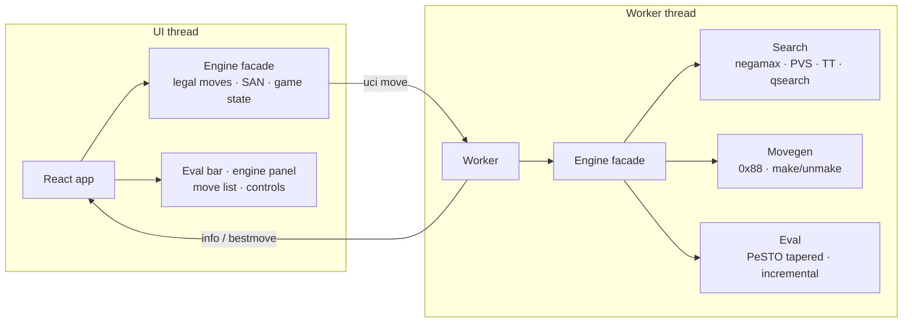

<div align="center">

# ♞ Chess0

**[▶ PLAY LIVE](https://aryan007h.github.io/chess0/)**

*A chess engine written 100% from scratch in TypeScript — rules, move generation,
evaluation and search — playing in your browser at over a million nodes per second,
with a self-play tuning loop and a trained NNUE in the pipeline.*


[](https://www.typescriptlang.org/)
[](https://react.dev/)
[](https://vite.dev/)
[](#verification--perft)
[](#verification--perft)
[](LICENSE)

</div>

---

## The pitch

No `chess.js`. No engine libraries. Every rule of chess — castling, en passant,
pins, the fifty-move rule — plus three generations of alpha-beta search run on
code in this repository, verified node-for-node against the standard perft test
suite and fast enough to see it think.

And the repo doesn't just *contain* an engine — it *improves one*. A texel
tuner, SPRT-style champion/challenger matches and self-chaining overnight
tuning sessions run on GitHub Actions, and a fully-quantized NNUE trained on
Lichess data rides along as a validated eval override.

## Features

**Play**

- Six strengths from **Random (400 Elo)** to **Chess0 v3 Grandmaster (2850+)** —
  Random / Beginner / Club / v1 Classic / v2 Positional / v3 Grandmaster
- **Rated competitive mode**: official Elo with deltas, fair-play lock hides all
  assistance until the game ends, then full Game Review unlocks
- **Coach-assisted learn mode**: 3-line hints, board arrows, takebacks
- Engine vs Engine spectator mode with auto-flip, pass & play, and
  **online friend matches** — invite link or 6-digit room code, live chat

**Coach Viktor**

- Every move you play is **classified live** (brilliant → best → inaccuracy →
  blunder, chess.com-style badges on the board and move list)
- Best-continuation suggestions with one-click play, spoken commentary (TTS)

**Analysis**

- **3-line Multi-PV** with color-ranked candidate arrows on the board
- **Game Review**: full engine pass with accuracy %, per-move classifications
  and an interactive evaluation graph
- **Opening explorer**: book continuations with master W/D/L stats, a curated
  GM repertoire, and tactical test positions

**Training**

- **Puzzle trainer**: 540 rated puzzles, streaks, progressive hints, theme catalog
- **Academy**: 16 courses / 432 interactive lessons with an on-board coach

**Interface**

- Multi-core **search fan-out** (lazy SMP across Web Workers, `Threads ×N`)
- 4 board themes, light/dark UI, drag & drop and click-to-move, legal-move dots,
  capture rings, last-move + check highlights, promotion picker, SAN move list,
  FEN load/copy, synthesized sounds — everything client-side, the UI never
  freezes because the engine runs in **Web Workers**

## The engine

| Layer | Choice |
| --- | --- |
| Board | **0x88 mailbox** in a single `Int8Array`; off-board tests are one AND |
| Moves | Packed into 32-bit ints; make/unmake with preallocated undo stacks — zero allocation on the hot path |
| Legality | Pin-aware cheap test (origin-line discovery check) with full attack scan only for king moves, en passant and check evasions |
| Hashing | Zobrist, two 32-bit halves; en-passant hashed only when actually capturable |
| Evaluation | **PeSTO** tapered eval (mg/eg piece-square tables blended by game phase), maintained incrementally — **~8 ns per call** |
| Chess0 v1 | Iterative deepening, negamax + PVS, quiescence with check evasions & delta pruning, MVV-LVA + killers + history ordering, transposition table, null-move pruning, LMR, check extension |
| Chess0 v2 | Aspiration windows, counter-moves, reverse futility / futility pruning, SEE-based pruning and an extended evaluation (pawn structure, bishop pair, rook files, mobility, king safety) |
| Chess0 v3 | **Grandmaster-grade**: 2M-entry TT probed in search *and* qsearch with TT-scored eval refinement, singular extensions, continuation/countermove/capture history with gravity updates, SEE-classified move ordering, razoring, ProbCut, late-move pruning, history-modulated LMR, a **hybrid opening book with novelty discovery at root**, and adaptive time management |
| Multi-core | **Lazy SMP** — the root position fans out to N Web Workers via message passing |
| NNUE | `768×32×2 → 32 → 1` **fully quantized (int16/int8)** net with incremental accumulator updates on the position stack; used as a validated eval override for v3 in engine matches while it banks rating games |

The engine never touches the DOM: the UI thread keeps its own lightweight
position for legality and SAN, while a Web Worker owns the search.



## Verification — perft

`npm run perft` walks the legal move tree and compares node counts against the
[six standard CPW positions](https://www.chessprogramming.org/Perft_Results) —
the definitive test for move-generation correctness.

| # | Position | Depth | Nodes | Result |
| --- | --- | --- | --- | --- |
| 1 | Initial position | 5 | 4,865,609 | ✅ |
| 2 | Kiwipete | 4 | 4,085,603 | ✅ |
| 3 | Position 3 | 6 | 11,030,083 | ✅ |
| 4 | Position 4 | 5 | 15,833,292 | ✅ |
| 5 | Position 5 | 4 | 2,103,487 | ✅ |
| 6 | Position 6 | 4 | 3,894,594 | ✅ |

A further **14-position edge-case suite** (en-passant pins, castling through
check, promotions out of check, underpromotion checks, stalemates — the
TalkChess tricky set) passes as well. Additional gates, all enforced in `npm test`:

- make/unmake random-walks: board, Zobrist hash, eval accumulators and piece
  counters must equal a from-scratch recomputation at every step
- mirrored-position eval symmetry; insufficient-material detection table
- `evalPos` under 100 ns (measured: **~8 ns**)
- known-mate searches (`Qxf7#`, `Rd8#`, a forced mate in 2) return mate scores
- SAN disambiguation, check/mate suffixes, FEN round-trip and rejection of invalid FENs
- NNUE regression tests: incremental accumulator updates (incl. the
  captured/stale-slot edge cases) must equal a from-scratch recompute

For the NNUE layer, `scripts/nnue-verify.ts` cross-checks the TypeScript
inference against the Python trainer's reference evals — a silent mismatch
between the two would produce a bad net, so parity is gated after every
training run (TS ↔ Python parity is exact).

## Benchmarks

Single thread — Intel i3-1115G4 (laptop), 1 s per position. `npm run bench`.

| Position | v1 | v2 | v3 Grandmaster |
| --- | --- | --- | --- |
| Startpos | depth 11 · 816 k nodes · 1.15 M nps | depth 12 · 387 k · 0.56 M | depth 12 · 164 k · 0.24 M |
| Kiwipete | depth 10 · 1.03 M nodes · 1.13 M nps | depth 11 · 388 k · 0.43 M | depth 10 · 206 k · 0.27 M |
| Endgame | depth 16 · 1.36 M nodes · 1.87 M nps | depth 18 · 876 k · 0.98 M | depth 13 · 337 k · 0.44 M |

Same 1 s budget: v2 reaches deeper with fewer raw nodes (richer eval costs
nps), and v3 plays strongest per node — heavier evaluation, history bookkeeping
and book consultation buy quality that raw node counts don't show. Perft itself
runs at **4–5 M nodes/s**.

## Getting started

```bash
npm install
npm run dev        # the app + multiplayer server at http://localhost:3000
npm test           # correctness suite (FEN, make/unmake, eval, SAN, mates, NNUE)
npm run perft      # full perft gate: 6 standard + 14 edge-case positions
npm run bench      # v1 vs v2 vs v3 search benchmark
npm run build      # typecheck + production build
```

### UCI mode

Chess0 speaks the UCI protocol, so it plugs into real chess GUIs
(Arena, Banksia, Cute Chess, …):

```bash
npm run uci
# or scripted:
echo -e "uci\nposition startpos\ngo depth 12\nquit" | npm run uci
```

## Multiplayer

Real-time 2-player matches over **three transports**, chosen by what's
available: server-authoritative WebSockets (`server.ts`, 6-digit room codes,
live chat), **PeerJS WebRTC DataChannels** for serverless play (GitHub Pages
has no backend — live matches still work), and `BroadcastChannel` for instant
multi-tab sync. All room updates are idempotent, keyed by room + ply + chat
id. Invite a friend with a link (`?room=CODE`) or code; pass & play works
fully offline. In development the same server serves the Vite app on port
3000.

## Training — NNUE from Lichess data

The whole pipeline runs on **zero local compute** — GitHub Actions for data,
free Kaggle GPUs for training (full runbook: [training/README.md](training/README.md)):

1. **Sample** the Lichess open game database (parquet) into a uniform
   position corpus, label it with **Stockfish** evaluations
   (`training/build_uniform_sample.py`, `training/sf_label.py`)
2. **Train** a quantization-aware PyTorch net (`training/nnue_train.py`) —
   int16 layer-1 accumulators, int8 layers 2–3 — with a distillation
   fine-tuning path (`--resume`)
3. **Verify**: the packed `data/nnue-v1.bin` header carries the architecture
   spec; `scripts/nnue-verify.ts` proves TS inference and the Python trainer
   agree, and every data path is POV-audited before a net is trusted
4. **Play**: the net plugs into v3 as an eval override for SPRT-style matches
   while it banks rating; the browser build keeps the hand-written eval until
   it earns the slot

## Self-tuning loop

- `scripts/texel-tune.ts` — texel tuning of the eval parameters on quiet
  positions, with a compact corpus + time budget
- `scripts/match.ts` — champion/challenger matches (80 games, ≥ 60 % score to
  accept) with wall-budget safety stops
- `scripts/tune-session.ts` — chains the cycle: tune → gate → publish the
  accepted champion → pick up the next parameter set automatically
- `.github/workflows/tune.yml` runs these as **matrix-parallel overnight
  self-chaining sessions** on GitHub Actions, so `main` gets stronger while
  you sleep

## Deployment

The site deploys to GitHub Pages automatically on every push to `main`
(`.github/workflows/deploy.yml` builds with `--base=/chess0/` and publishes
`dist/`). Any static host works: `npm run build` produces a self-contained
`dist/` folder — drop it on Vercel or Netlify with zero configuration.
The tuning and NNUE data workflows (`.github/workflows/tune.yml`,
`nnue-data.yml`, `nnue-smoke.yml`) are repository automations, not page builds.

## Project layout

```
src/engine/          the engine — no DOM, no React, pure TypeScript
  types.ts position.ts movegen.ts zobrist.ts   core: 0x88, make/unmake, hashing
  psto.ts eval.ts evalV2.ts evalV3.ts see.ts     three eval generations + SEE
  search.ts searchV2.ts searchV3.ts              three search generations
  bookV3.ts                                      hybrid opening book + repertoire
  nnue.ts                                        quantized NNUE inference
  san.ts analysis.ts engine.ts worker.ts         SAN, classification, facade, worker
  puzzles.ts lessons.ts                          puzzle + academy content
src/                 React workbench UI (Vite + Tailwind)
scripts/             perft · bench · test · uci · texel-tune · match · tune-session
                     gen-nnue-data · nnue-verify · parity · profiling
training/            Python NNUE pipeline: trainer, Stockfish labeling,
                     corpus sampling, Kaggle runbook
server.ts            Express + ws multiplayer server (dev: serves the app too)
.github/workflows/   deploy · tune · nnue-data · nnue-smoke
```

## Contributing

Contributions are very welcome — UI polish, puzzle/lesson content, opening
book data, docs, tests, and engine ideas all count. Start here:

- [ARCHITECTURE.md](ARCHITECTURE.md) — how the whole system fits together
- [CONTRIBUTING.md](CONTRIBUTING.md) — setup, gates and PR process
- [ROADMAP.md](ROADMAP.md) — the strength roadmap (texel tuning → NNUE →
  distillation → bigger nets)
- [CODE_OF_CONDUCT.md](CODE_OF_CONDUCT.md) — be decent, critique code not people

This repo is partly developed with AI coding agents under an explicit
protocol — see [AGENTS.md](AGENTS.md).

## License

[MIT](LICENSE) — the PeSTO evaluation tables are from the Chess Programming
Wiki (CC BY-SA); NNUE training positions come from the Lichess open game
database.
